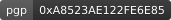
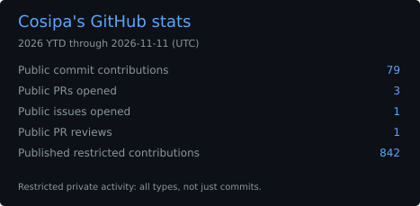
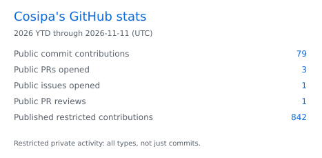
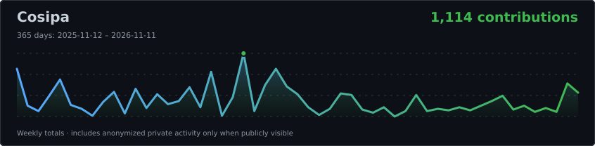
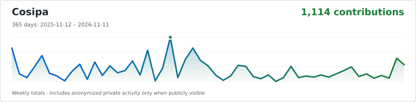
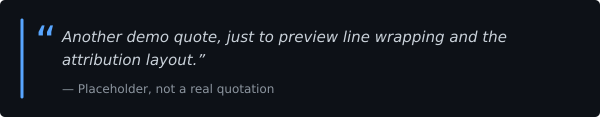
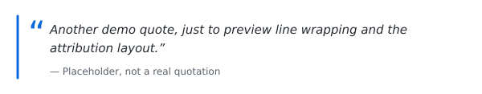

<!-- Layout is hand-edited; GitHub Actions refreshes only the marked regions. -->

  

<h3 align="center">Cosipa</h3>

Welcome, hope you find what you are looking for.

<!-- profile:typing:start -->

<!-- profile:typing:end -->

  <a href="https://github.com/Cosipa?tab=repositories">Projects</a> ·
  <a href="https://github.com/Cosipa?tab=stars">Things I find interesting</a> ·
  <a href="https://cosipa.dev/">Blog</a>

<!-- profile:pgp:start -->

<!-- profile:pgp:end -->

## Toolbox

## Self-hosting

## Latest posts

<!-- profile:posts47:start -->
<table>
<tr>
<td width="20%" valign="top">October 18, 2026</td>
<td valign="top">

**[A user in the Docker group can become root](https://cosipa.dev/posts/docker-group-security-risk/)**

> This is a well-known (very old) Docker security risk, that everybody knows exists, yet
> sometimes we underestimate the impact of it.

</td>
</tr>
<tr>
<td width="20%" valign="top">August 5, 2026</td>
<td valign="top">

**[How to setup a pull-through Docker registry](https://cosipa.dev/posts/docker-registry-cache-setup/)**

> A pull-through Docker registry is basically just a cached proxy to DockerHub, instead
> of having your servers pulling images from DockerHub directly, they could pull them
> from your own registry.

</td>
</tr>
<tr>
<td width="20%" valign="top">July 25, 2026</td>
<td valign="top">

**[How to speed up Linux disk encryption](https://cosipa.dev/posts/full-disk-encryption-tweaks/)**

> What is dm-crypt: Device-Mapper’s crypt provides transparent encryption of block
> devices using the kernel crypto API.

</td>
</tr>
</table>
<!-- profile:posts47:end -->

[More on my blog →](https://cosipa.dev/)

## Open source

### Open pull requests & issues

<!-- profile:activity:start -->
| Status | Repository | Title |
| :---: | :-- | :-- |
|  | `NixOS/nixpkgs` | [zap: install desktop icons](https://github.com/NixOS/nixpkgs/pull/585770) · #585770 |
|  | `NixOS/nixpkgs` | [fido2-manage: update to 0.2.2](https://github.com/NixOS/nixpkgs/pull/585745) · #585745 |
|  | `NixOS/nixpkgs` | [iproute2: 7.2.0 \-&gt; 7.3.0](https://github.com/NixOS/nixpkgs/pull/585573) · #585573 |
|  | `maxdorninger/MediaManager` | [\[BUG\] Prowlarr magnet redirect is discarded before Transmission grab](https://github.com/maxdorninger/MediaManager/issues/574) · #574 |
<!-- profile:activity:end -->

### Recently merged pull requests

<!-- profile:merged:start -->
| Status | Repository | Title | Merged (UTC) |
| :---: | :-- | :-- | :-- |
| — | — | No merged public pull requests found. | — |
<!-- profile:merged:end -->

## GitHub activity

<!-- profile:snake:start -->

<!-- profile:snake:end -->

### Public contribution stats

<!-- profile:stats:start -->

<!-- profile:stats:end -->

### This year's weekly line graph

<!-- profile:timeline:start -->

<!-- profile:timeline:end -->

## One of my personally favorite quotes

<!-- profile:quote:start -->

<!-- profile:quote:end -->

[↑ Go back to the top](#top)
