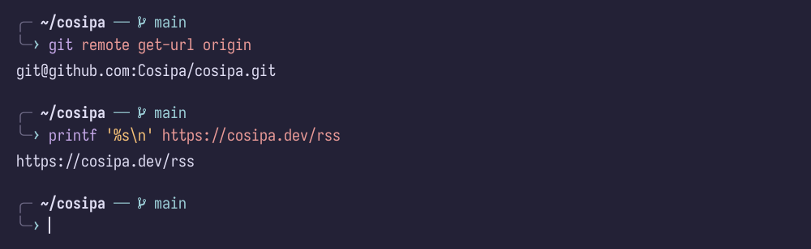
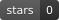
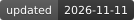
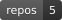
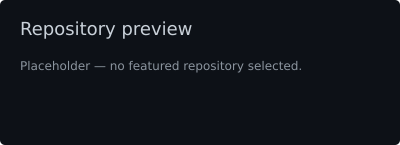
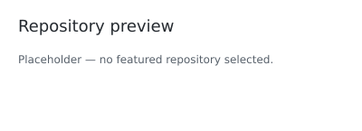
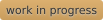
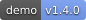
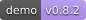

<!-- Unused profile components. Layout stays hand-edited; marked regions are refreshed by GitHub Actions. -->

# Unused profile components

[Working components](#working) · [Mockups & setup pending](#mockups) · [Blog alternatives](#real-posts)

These options are not used in [the profile README](../README.md). Original numbers are kept for reference. Everything is visible—no expanding sections.

# Working components

These unused components already render or refresh successfully. GitHub Actions updates the marked regions using public GitHub data and your RSS. Assets are repository-hosted.

## 03 · Your terminal styling

Rosé Pine Moon, your two-line Fish/Starship prompt and branch symbol, no title bar or window buttons, and a steady beam cursor.

Styling recreation, not a screenshot. Uses the installed IosevkaTerm Nerd Font from your Kitty/Foot setup. Glyphs are rendered as paths so font fallback cannot change the image.

## 07 · Live GitHub badges

**Public GitHub data, rendered locally.** Rounded ends, subtle shading, and text shadows matching the other flat badges.

<!-- profile:github-badges:start -->

<!-- profile:github-badges:end -->

## 48 · Quieter excerpt layouts

Both alternatives below are already automated from [your RSS feed](https://cosipa.dev/rss). The README uses compact magazine rows (47); these remain available as alternatives.

### 48A · Ordinary blockquotes

<!-- profile:posts48a:start -->
> **[A user in the Docker group can become root](https://cosipa.dev/posts/docker-group-security-risk/)** · Oct 18, 2026
>
> This is a well-known (very old) Docker security risk, that everybody knows exists, yet
> sometimes we underestimate the impact of it.

<!-- -->

> **[How to setup a pull-through Docker registry](https://cosipa.dev/posts/docker-registry-cache-setup/)** · Aug 05, 2026
>
> A pull-through Docker registry is basically just a cached proxy to DockerHub, instead
> of having your servers pulling images from DockerHub directly, they could pull them
> from your own registry.

<!-- -->

> **[How to speed up Linux disk encryption](https://cosipa.dev/posts/full-disk-encryption-tweaks/)** · Jul 25, 2026
>
> What is dm-crypt: Device-Mapper’s crypt provides transparent encryption of block
> devices using the kernel crypto API.
<!-- profile:posts48a:end -->

### 48B · Unframed excerpts

<!-- profile:posts48b:start -->
**[A user in the Docker group can become root](https://cosipa.dev/posts/docker-group-security-risk/)** · Oct 18, 2026

This is a well-known (very old) Docker security risk, that everybody knows exists, yet
sometimes we underestimate the impact of it.

---

**[How to setup a pull-through Docker registry](https://cosipa.dev/posts/docker-registry-cache-setup/)** · Aug 05, 2026

A pull-through Docker registry is basically just a cached proxy to DockerHub, instead
of having your servers pulling images from DockerHub directly, they could pull them
from your own registry.

---

**[How to speed up Linux disk encryption](https://cosipa.dev/posts/full-disk-encryption-tweaks/)** · Jul 25, 2026

What is dm-crypt: Device-Mapper’s crypt provides transparent encryption of block
devices using the kernel crypto API.
<!-- profile:posts48b:end -->

---

# Mockups & setup pending

These are **not finished personal content**. Some are visual mockups; others have working rendering but still need your content or configuration. They are kept separate from the working data above.

## 17 · Metrics panels

**Unimplemented · upstream demos, not your account.** Metrics was explicitly excluded from the earlier Actions implementation because you planned to configure it yourself. That includes the achievement wall: no personal Metrics output or Metrics workflow has been configured here. These images are examples, not evidence of your stats or achievements.

### Achievement wall · not configured

## 19 · Repository preview card

**Placeholder.** No featured repository is selected yet.

<!-- profile:repository-placeholder:start -->

<!-- profile:repository-placeholder:end -->

## 21 · Two-column project gallery

**Illustrative copy, not actual project descriptions.**

<table>
<tr>
<td width="50%" valign="top">

### 🛠️ The useful thing

One sentence explaining the problem it solves, not just the language it's written in.

[Source](https://github.com/Cosipa?tab=repositories)

</td>
<td width="50%" valign="top">

### 🧪 The weird experiment

The one that exists because you wanted to understand how something works.

[Source](https://github.com/Cosipa?tab=repositories)

</td>
</tr>
</table>

## 22 · Release board

**Mockup · fictional projects and versions.**

| Project | Latest | What's new |
| :-- | :-- | :-- |
| `sidequest` |  | Startup is no longer a coffee break. |
| `tiny-parser` |  | Error messages now attempt to help. |
| `homelab-notes` |  | Another diagram of the same server. |

## Decorative footer

<!-- profile:footer:start -->

<!-- profile:footer:end -->
