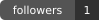
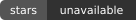
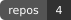
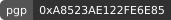
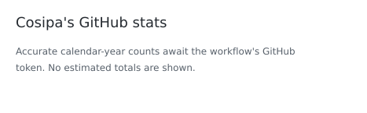
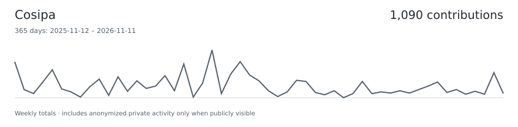
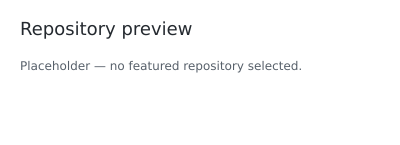

<!-- Profile shortlist. Layout stays hand-edited; marked regions are refreshed by GitHub Actions. -->

<!-- profile:header:start -->

<!-- profile:header:end -->

# Profile shortlist

[Headers](#headers) · [Badges](#badges) · [GitHub data](#github-data) · [Projects & activity](#projects) · [Other experiments](#other) · [Blog layouts](#real-posts)

Original numbers are kept so we can keep referring to them. Everything is visible—no expanding sections.

GitHub Actions refreshes marked sections using public GitHub data and your RSS. Assets are hosted in this repository; Komarev is the only separate widget service. Metrics remains an explicitly labeled upstream demo. Project placeholders remain placeholders.

# Headers

## 01 · Animated typing introduction

**Local animated SVG · sample copy.** Edit `profile.toml` to choose the text.

<!-- profile:typing:start -->

<!-- profile:typing:end -->

## 03 · Your terminal styling

Rosé Pine Moon, your two-line Fish/Starship prompt and branch symbol, no title bar or window buttons, and a steady beam cursor.

Styling recreation, not a screenshot. Uses the installed IosevkaTerm Nerd Font from your Kitty/Foot setup. Glyphs are rendered as paths so font fallback cannot change the image. New asset URL to avoid reusing the old cached illustration.

## 04 · Native avatar + a centered intro

**Live avatar · sample introduction.**

  

<h3 align="center">Cosipa</h3>

A short sentence about what you build, what you care about, and why someone should stick around.

  <a href="https://github.com/Cosipa?tab=repositories">Projects</a> ·
  <a href="https://github.com/Cosipa?tab=stars">Things I find interesting</a> ·
  <a href="https://cosipa.dev/">Writing</a>

# Badges

## 05 · Flat tool badges

**Sample stack, not an inventory of your skills.** Only the flat style remains.

## 07 · Muted live GitHub badges

**Public GitHub data, rendered locally.** One flat style, neutral colors, no social counters or plastic effects.

<!-- profile:github-badges:start -->

<!-- profile:github-badges:end -->

## 18 · PGP + profile views

<!-- profile:pgp:start -->

<!-- profile:pgp:end -->

The key ID is from the primary public key served by your GitHub `.gpg` URL. Views are approximate image requests, not unique visitors.

# GitHub data

## 09 · Classic stats card

**Your public contribution data, with explicit calendar-year dates.** Commit contributions are GitHub-eligible public commits, not every Git commit on every branch. Any published private total is labeled contributions, never commits.

<!-- profile:stats:start -->
<picture>
  <source media="(prefers-color-scheme: dark)" srcset="./profile-showcase/generated/stats-dark.9b85f3b3800b.svg">
  <source media="(prefers-color-scheme: light)" srcset="./profile-showcase/generated/stats-light.c609fce36dcf.svg">
  
</picture>
<!-- profile:stats:end -->

Neutral gray palette. Separate light/dark images selected by the color-scheme media query. Missing data is not presented as zero.

[Local generator](./scripts/update_profile.py) · [Counting definitions](./PROFILE_SETUP.md#counting-definitions)

## 12 · Wide contribution timeline

**Your publicly visible contributions over an explicit 365-day window.** The headline is checked against the sum of the daily counts.

<!-- profile:timeline:start -->
<picture>
  <source media="(prefers-color-scheme: dark)" srcset="./profile-showcase/generated/timeline-dark.66c204f57809.svg">
  <source media="(prefers-color-scheme: light)" srcset="./profile-showcase/generated/timeline-light.a9aa123f05d1.svg">
  
</picture>
<!-- profile:timeline:end -->

GitHub-native light/dark palettes, selected by the color-scheme media query. Publicly published private activity may be included in the graph.

[GitHub's own contribution calendar](https://github.com/users/Cosipa/contributions)

## 14 · Contribution snake

**Your contribution grid.** Generated by the SHA-pinned snake Action; the animation is a repository-hosted SVG, not a live widget.

<!-- profile:snake:start -->
<picture>
  <source media="(prefers-color-scheme: dark)" srcset="./profile-showcase/generated/snake-dark-pending.042e9c9fd6d1.svg">
  <source media="(prefers-color-scheme: light)" srcset="./profile-showcase/generated/snake-light-pending.eb8b9bf05507.svg">
  
</picture>
<!-- profile:snake:end -->

[Generator](https://github.com/Platane/snk)

## 17 · Metrics panels

**Upstream demos · not your account.** All panels are visible, not hidden behind a toggle.

### Achievement wall

# Projects & activity

## 19 · Repository preview card

**Placeholder.** No featured repository is selected yet.

<!-- profile:repository-placeholder:start -->
<picture>
  <source media="(prefers-color-scheme: dark)" srcset="./profile-showcase/generated/repository-placeholder-dark.a543fce88cf0.svg">
  <source media="(prefers-color-scheme: light)" srcset="./profile-showcase/generated/repository-placeholder-light.35e31349540e.svg">
  
</picture>
<!-- profile:repository-placeholder:end -->

Same neutral light/dark palette as #09.

## 21 · Two-column project gallery

**Illustrative copy, not actual project descriptions.**

<table>
<tr>
<td width="50%" valign="top">

### 🛠️ The useful thing

One sentence explaining the problem it solves, not just the language it's written in.

[Source](https://github.com/Cosipa?tab=repositories)

</td>
<td width="50%" valign="top">

### 🧪 The weird experiment

The one that exists because you wanted to understand how something works.

[Source](https://github.com/Cosipa?tab=repositories)

</td>
</tr>
</table>

## 22 · Release board

**Mockup · fictional projects and versions.**

| Project | Latest | What's new |
| :-- | :-- | :-- |
| `sidequest` |  | Startup is no longer a coffee break. |
| `tiny-parser` |  | Error messages now attempt to help. |
| `homelab-notes` |  | Another diagram of the same server. |

## 24 · Open pull requests and issues

**Actual public activity, refreshed by Actions.** Up to 12 open items only, using locally stored status badges. Not an instant status check.

<!-- profile:activity:start -->
| Status | Repository | Title |
| :-- | :-- | :-- |
|  | `NixOS/nixpkgs` | [zap: install desktop icons](https://github.com/NixOS/nixpkgs/pull/585770) · #585770 |
|  | `NixOS/nixpkgs` | [fido2-manage: update to 0.2.2](https://github.com/NixOS/nixpkgs/pull/585745) · #585745 |
|  | `NixOS/nixpkgs` | [iproute2: 7.2.0 \-&gt; 7.3.0](https://github.com/NixOS/nixpkgs/pull/585573) · #585573 |
|  | `maxdorninger/MediaManager` | [\[BUG\] Prowlarr magnet redirect is discarded before Transmission grab](https://github.com/maxdorninger/MediaManager/issues/574) · #574 |
<!-- profile:activity:end -->

# Other experiments

## 37 · Your own quote card

**Your quotes only.** Edit [`quotes.txt`](./quotes.txt); the workflow selects one deterministically each UTC day and renders both themes. An empty file shows an explicit setup notice, not a fabricated quote.

<!-- profile:quote:start -->
<a href="./quotes.txt">
<picture>
  <source media="(prefers-color-scheme: dark)" srcset="./profile-showcase/generated/quote-dark.9d2f86009c46.svg">
  <source media="(prefers-color-scheme: light)" srcset="./profile-showcase/generated/quote-light.869ca8b01aa4.svg">
  
</picture>
</a>
<!-- profile:quote:end -->

# Writing · cosipa.dev

Only **42**, **47**, and **48** remain. Actions refreshes all three from [your RSS feed](https://cosipa.dev/rss), retaining exact titles, dates, and first-sentence excerpts. No rewritten headlines or generated article images.

[42 · Cards](#42--two-column-text-cards) · [47 · Rows](#47--compact-magazine-rows) · [48 · Quieter excerpt layouts](#48--quieter-excerpt-layouts)

## 42 · Two-column text cards

<!-- profile:posts42:start -->
<table>
<tr>
<td width="50%" valign="top">

### [A user in the Docker group can become root](https://cosipa.dev/posts/docker-group-security-risk/)

October 18, 2026

> This is a well-known (very old) Docker security risk, that everybody knows exists, yet
> sometimes we underestimate the impact of it.

</td>
<td width="50%" valign="top">

### [How to setup a pull-through Docker registry](https://cosipa.dev/posts/docker-registry-cache-setup/)

August 5, 2026

> A pull-through Docker registry is basically just a cached proxy to DockerHub, instead
> of having your servers pulling images from DockerHub directly, they could pull them
> from your own registry.

</td>
</tr>
<tr>
<td width="50%" valign="top">

### [How to speed up Linux disk encryption](https://cosipa.dev/posts/full-disk-encryption-tweaks/)

July 25, 2026

> What is dm-crypt: Device-Mapper’s crypt provides transparent encryption of block
> devices using the kernel crypto API.

</td>
<td width="50%" valign="top">

### [First post ever](https://cosipa.dev/posts/first-post-ever/)

October 2, 2025

> Welcome to my tech blog, this post just serves as a placeholder until I write a full
> post.

</td>
</tr>
</table>
<!-- profile:posts42:end -->

## 47 · Compact magazine rows

<!-- profile:posts47:start -->
<table>
<tr>
<td width="20%" valign="top">October 18, 2026</td>
<td valign="top">

**[A user in the Docker group can become root](https://cosipa.dev/posts/docker-group-security-risk/)**

> This is a well-known (very old) Docker security risk, that everybody knows exists, yet
> sometimes we underestimate the impact of it.

</td>
</tr>
<tr>
<td width="20%" valign="top">August 5, 2026</td>
<td valign="top">

**[How to setup a pull-through Docker registry](https://cosipa.dev/posts/docker-registry-cache-setup/)**

> A pull-through Docker registry is basically just a cached proxy to DockerHub, instead
> of having your servers pulling images from DockerHub directly, they could pull them
> from your own registry.

</td>
</tr>
<tr>
<td width="20%" valign="top">July 25, 2026</td>
<td valign="top">

**[How to speed up Linux disk encryption](https://cosipa.dev/posts/full-disk-encryption-tweaks/)**

> What is dm-crypt: Device-Mapper’s crypt provides transparent encryption of block
> devices using the kernel crypto API.

</td>
</tr>
</table>
<!-- profile:posts47:end -->

## 48 · Quieter excerpt layouts

The same three latest posts, with identical RSS titles and excerpts. No NOTE alerts.

### 48A · Ordinary blockquotes

<!-- profile:posts48a:start -->
> **[A user in the Docker group can become root](https://cosipa.dev/posts/docker-group-security-risk/)** · Oct 18, 2026
>
> This is a well-known (very old) Docker security risk, that everybody knows exists, yet
> sometimes we underestimate the impact of it.

<!-- -->

> **[How to setup a pull-through Docker registry](https://cosipa.dev/posts/docker-registry-cache-setup/)** · Aug 05, 2026
>
> A pull-through Docker registry is basically just a cached proxy to DockerHub, instead
> of having your servers pulling images from DockerHub directly, they could pull them
> from your own registry.

<!-- -->

> **[How to speed up Linux disk encryption](https://cosipa.dev/posts/full-disk-encryption-tweaks/)** · Jul 25, 2026
>
> What is dm-crypt: Device-Mapper’s crypt provides transparent encryption of block
> devices using the kernel crypto API.
<!-- profile:posts48a:end -->

### 48B · Unframed excerpts

<!-- profile:posts48b:start -->
**[A user in the Docker group can become root](https://cosipa.dev/posts/docker-group-security-risk/)** · Oct 18, 2026

This is a well-known (very old) Docker security risk, that everybody knows exists, yet
sometimes we underestimate the impact of it.

---

**[How to setup a pull-through Docker registry](https://cosipa.dev/posts/docker-registry-cache-setup/)** · Aug 05, 2026

A pull-through Docker registry is basically just a cached proxy to DockerHub, instead
of having your servers pulling images from DockerHub directly, they could pull them
from your own registry.

---

**[How to speed up Linux disk encryption](https://cosipa.dev/posts/full-disk-encryption-tweaks/)** · Jul 25, 2026

What is dm-crypt: Device-Mapper’s crypt provides transparent encryption of block
devices using the kernel crypto API.
<!-- profile:posts48b:end -->

### 48C · Green TIP callouts, for comparison

These still introduce a colored label. Compare with the quieter versions above.

<!-- profile:posts48c:start -->
> [!TIP]
> **[A user in the Docker group can become root](https://cosipa.dev/posts/docker-group-security-risk/)** · Oct 18, 2026
>
> This is a well-known (very old) Docker security risk, that everybody knows exists, yet
> sometimes we underestimate the impact of it.

<!-- -->

> [!TIP]
> **[How to setup a pull-through Docker registry](https://cosipa.dev/posts/docker-registry-cache-setup/)** · Aug 05, 2026
>
> A pull-through Docker registry is basically just a cached proxy to DockerHub, instead
> of having your servers pulling images from DockerHub directly, they could pull them
> from your own registry.

<!-- -->

> [!TIP]
> **[How to speed up Linux disk encryption](https://cosipa.dev/posts/full-disk-encryption-tweaks/)** · Jul 25, 2026
>
> What is dm-crypt: Device-Mapper’s crypt provides transparent encryption of block
> devices using the kernel crypto API.
<!-- profile:posts48c:end -->

[cosipa.dev](https://cosipa.dev/) · [RSS](https://cosipa.dev/rss) · [↑ Back to top](#profile-shortlist)

<!-- profile:footer:start -->

<!-- profile:footer:end -->
