<!-- Experimental showroom, NOT the final profile. No workflows are installed by this file. -->

<p align="center">
  
</p>

<p align="center">
  <a href="#headers">Headers</a> ·
  <a href="#badges">Badges</a> ·
  <a href="#github-data">GitHub data</a> ·
  <a href="#projects">Projects</a> ·
  <a href="#personal">Personal stuff</a> ·
  <a href="#markdown-tricks">GitHub tricks</a> ·
  <a href="#recipes">How it works</a> ·
  <a href="#shortlist">Shortlist</a>
</p>

# The everything profile

**This page is a tasting flight, not a design recommendation.** Scroll, look, pick favorites by number. Repetition and incompatible styles are intentional.

> [!IMPORTANT]
> **LIVE / COSIPA** = a widget requesting public data for `Cosipa`.
> **UPSTREAM DEMO** = somebody else's published example, not your stats.
> **LOCAL MOCKUP** = illustrative content committed with this page; not a claim about your interests, projects, listening history, or activity.
>
> External images may be cached, unavailable, or change later. Embedded services receive image requests, often through GitHub's proxy. Nothing here has access to private data or credentials. No Actions or automatic updates have been enabled.

<a id="headers"></a>

# A · Entrances, headers, and visual identity

## 01 · Animated typing introduction

**LIVE SERVICE · sample copy.** This is an SVG image, not JavaScript running in GitHub.

[](https://readme-typing-svg.demolab.com/)

[Customize the typing effect](https://readme-typing-svg.demolab.com/)

## 02 · Custom banner that changes with GitHub's theme

**LOCAL ASSET · sample copy.** Switch GitHub between light and dark themes to compare. Both SVGs live in this repository.

<picture>
  <source media="(prefers-color-scheme: dark)" srcset="./profile-showcase/header-dark.svg">
  <source media="(prefers-color-scheme: light)" srcset="./profile-showcase/header-light.svg">
  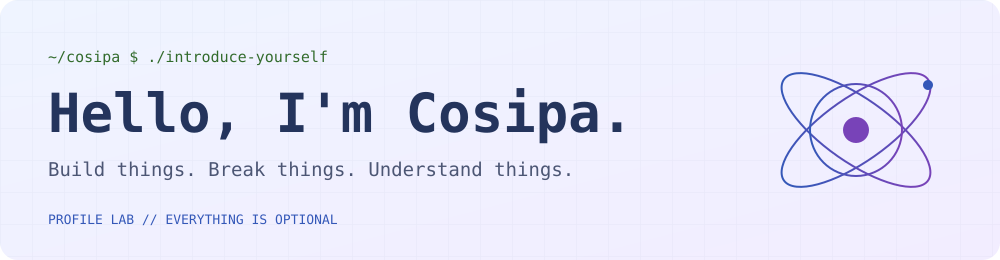
</picture>

<details>
<summary>Compare both versions without changing your theme</summary>

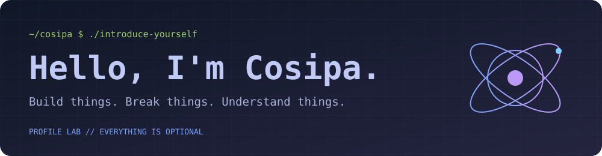


</details>

## 03 · Terminal-style profile, including a blinking cursor

**LOCAL MOCKUP.** The cursor is animated inside the SVG. Everything else is just an image.

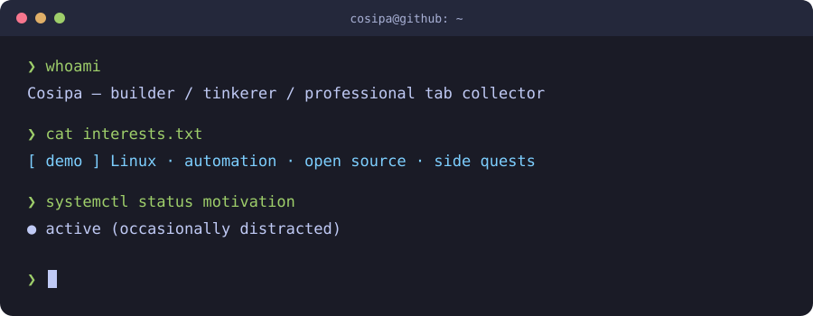

## 04 · Native avatar + a centered intro

**LIVE AVATAR · sample introduction.** More understated than the giant graphics.

<p align="center">
  
</p>
<h3 align="center">Cosipa</h3>
<p align="center">A short sentence about what you build, what you care about, and why someone should stick around.</p>
<p align="center">
  <a href="https://github.com/Cosipa?tab=repositories">Projects</a> ·
  <a href="https://github.com/Cosipa?tab=stars">Things I find interesting</a> ·
  <a href="#28--a-uses-page-hidden-in-plain-sight">My setup</a>
</p>

<a id="badges"></a>

# B · Badge buffet

## 05 · Four badge styles, same idea

**LIVE SERVICE · sample stack, not an inventory of your skills.**

**For the badge**


**Flat**


**Flat square**


**Plastic / old-school**


## 06 · Icon tiles instead of text badges

**LIVE SERVICE · sample stack.** Tiles link to the icon generator, not to a claim of proficiency.

[](https://skillicons.dev/)

<details>
<summary>Light tile variant</summary>

[](https://skillicons.dev/)

</details>

## 07 · Live GitHub badges

**LIVE / COSIPA.** Click through to the underlying GitHub pages.

[](https://github.com/Cosipa?tab=followers)
[](https://github.com/Cosipa/cosipa/stargazers)
[](https://github.com/Cosipa/cosipa/commits)
[](https://github.com/Cosipa?tab=repositories)

The final badge reads a JSON API. The same pattern can display a value from **your own public endpoint**.

## 08 · Personality badges

**STATIC LABELS · sample copy.** These can be links, jokes, or actual status labels.


<a id="github-data"></a>

# C · GitHub data, graphs, and gratuitous animation

## 09 · Classic stats card

**LIVE / COSIPA.** Public GitHub data via a community-hosted stats service. The grade is the service's opinion, not an objective developer rating.


[Service source](https://github.com/pranesh-2005/github-readme-stats-fast) · [Original stats-card project](https://github.com/anuraghazra/github-readme-stats)

## 10 · Language card

**LIVE / COSIPA.** Repository language distribution, **not** a skill ranking or a record of all your coding.


## 11 · Streak card

**LIVE / COSIPA.** A very different visual treatment of contribution history.

[](https://github.com/DenverCoder1/github-readme-streak-stats)

## 12 · Wide contribution timeline

**LIVE / COSIPA.** A full-width card rather than a collection of small boxes.

[](https://github.com/vn7n24fzkq/github-profile-summary-cards)

## 13 · The tiny dashboard wall

**LIVE / COSIPA.** Compare a few chart types side by side. The time-of-day chart uses UTC, not an inferred personal timezone.

<p>
  
  
  
</p>

## 14 · A snake eats the contribution grid

**UPSTREAM DEMO · Platane's contribution data, not yours.** An Action can generate the same animation using `Cosipa` later. See the recipe at the bottom.

<picture>
  <source media="(prefers-color-scheme: dark)" srcset="https://raw.githubusercontent.com/Platane/snk/output/github-contribution-grid-snake-dark.svg">
  
</picture>

[Generator: Platane/snk](https://github.com/Platane/snk)

## 15 · Your contributions become a 3D city

**UPSTREAM DEMO · yoshi389111's data, not yours.** The generated image is static, not an interactive 3D canvas.

[](https://github.com/yoshi389111/github-profile-3d-contrib)

## 16 · Isometric contribution calendar

**UPSTREAM DEMO · lowlighter/metrics example data.** Similar information, completely different aesthetic.

[](https://github.com/lowlighter/metrics/tree/master/source/plugins/isocalendar)

## 17 · All-in-one metrics panel

**UPSTREAM DEMO · not your account.** Metrics can generate a custom composition of modules instead of embedding five unrelated services.

[](https://github.com/lowlighter/metrics)

<details>
<summary>MORE DASHBOARDS: language analysis, habits, achievements, and star history</summary>

### Language analysis


### Coding habits


### Achievement wall


### Star history


All four are upstream examples. The habits and achievement modules have their own definitions; they are not authoritative measures of productivity.

</details>

## 18 · Visitor counter

**LIVE SERVICE.** Included because it is a common trick, not because the number is meaningful. Image caching, bots, proxy requests, and reloads make this **not a unique-person count**. Viewing this demo may increment it.


[Counter source](https://github.com/antonkomarev/github-profile-views-counter)

<a id="projects"></a>

# D · Show the work, not just the numbers

## 19 · Repository preview card

**LIVE / COSIPA.** This points at the profile repository itself; later we'd feature actual projects.

[](https://github.com/Cosipa/cosipa)

## 20 · Big clickable project screenshot / cover

**LOCAL MOCKUP · fictional project.** Click it to see the example SVG source, not a nonexistent repository. A real version could use a screenshot or animated GIF of your app.

[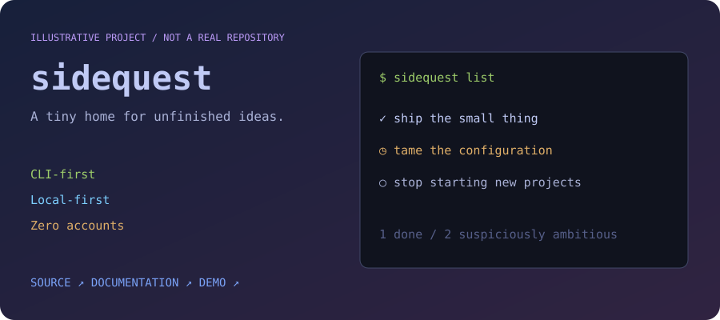](./profile-showcase/project-preview.svg)

## 21 · Two-column project gallery

**ILLUSTRATIVE COPY.** A plain HTML table gives you predictable columns without CSS. On narrow screens, expect less room.

<table>
<tr>
<td width="50%" valign="top">

### 🛠️ The useful thing

One sentence explaining the problem it solves, not just the language it's written in.


**Example links:** [Source](https://github.com/Cosipa?tab=repositories) · [Preview style](#20--big-clickable-project-screenshot--cover)

</td>
<td width="50%" valign="top">

### 🧪 The weird experiment

The one that exists because you wanted to understand how something works.


**Example links:** [Source](https://github.com/Cosipa?tab=repositories) · [Architecture style](#30--mermaid-diagrams-rendered-by-github)

</td>
</tr>
</table>

## 22 · Release board

**LOCAL MOCKUP · fictional project names and versions.** A workflow could replace these rows with real GitHub release data.

| Project | Latest | What's new |
| :-- | :-- | :-- |
| `sidequest` |  | Startup is no longer a coffee break. |
| `tiny-parser` |  | Error messages now attempt to help. |
| `homelab-notes` |  | Another diagram of the same server. |

## 23 · Latest writing / videos / talks

**LOCAL MOCKUP.** This is what an RSS-updated section can look like. No fake article links, no feed configured yet.

<!-- BLOG-POST-LIST:START -->
- **[Example]** The tiny tool that replaced my increasingly complicated shell alias
- **[Example]** What I learned by breaking my home lab
- **[Example]** Notes from building a thing nobody asked for
<!-- BLOG-POST-LIST:END -->

The same pattern can list YouTube videos, podcast episodes, release notes, or conference talks. See the RSS recipe below.

## 24 · Recent activity feed

**LOCAL MOCKUP.** This could be generated from public GitHub events instead of manually maintained.

```text
[example] merged       a small fix with a disproportionately long explanation
[example] released     the thing that finally has a version number
[example] opened       an issue with a minimal reproduction (a good day)
[example] contributed  documentation to somebody else's project
```

<a id="personal"></a>

# E · Personality, music, and side quests

## 25 · Now-playing music card

**LOCAL ANIMATED MOCKUP.** Not connected to Spotify, Last.fm, or any listening history. A real integration can generate an image like this using your account's authorized data.

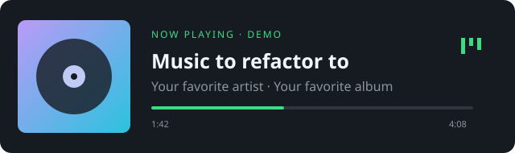

[Spotify widget project](https://github.com/kittinan/spotify-github-profile) · [Last.fm API](https://www.last.fm/api)

GitHub's image cache means “now playing” may lag. Tokens belong on the generator/server, **never** in the README or image URL.

## 26 · Coding-time dashboard

**UPSTREAM DEMO · not your work patterns.** Requires a time-tracking setup such as WakaTime if you want actual personal numbers.

[](https://github.com/athul/waka-readme)

## 27 · A now page

**LOCAL MOCKUP · replace every line with something true.** This is deliberately more human than a chart.

| | Currently… |
| :-- | :-- |
| 🔨 Building | One useful thing and three distractions |
| 🌱 Learning | The part I thought I already understood |
| 📖 Reading | Something with too many sticky notes |
| 🎮 Playing | The backlog, in theory |
| 💬 Happy to discuss | Tiny tools, good defaults, and questionable side projects |

## 28 · A uses page, hidden in plain sight

**LOCAL MOCKUP.** You can keep the first screen short without losing the nerdy details.

<details>
<summary><b>🖥️ Expand the setup / dotfiles / home-lab rabbit hole</b></summary>

### Daily drivers

| Category | Example placeholder |
| :-- | :-- |
| OS | Your distro / desktop |
| Editor | Your editor and the one plugin you won't stop recommending |
| Shell | Your shell, terminal, and prompt |
| Keyboard | The normal one or the expensive rabbit hole |
| Dotfiles | Add an actual repository link here |

### Things running somewhere

- A service you genuinely use.
- A backup system you actually test.
- One machine with a name that made sense at the time.

<details>
<summary>Even deeper: needlessly strong opinions</summary>

- A good error message is a feature.
- The best dependency is sometimes a small function.
- Every temporary script deserves the chance to become infrastructure.

*All of this is sample copy, not a declaration of your beliefs.*

</details>
</details>

## 29 · Personal telemetry, generated your way

**LOCAL MOCKUP · invented numbers.** Could be generated from a small YAML file, a books API, public package downloads, or your own services.

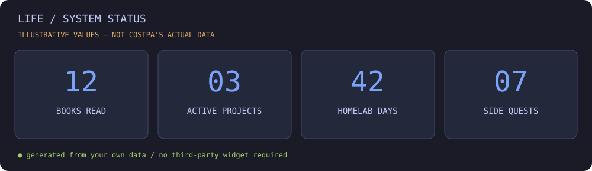

<details>
<summary>Possible source data</summary>

```yaml
# Example values only. A generator could turn this into an SVG.
books_read: 12
active_projects: 3
homelab_days: 42
side_quests: 7
currently_building: "A tiny useful thing"
```

</details>

<a id="markdown-tricks"></a>

# F · Things GitHub itself can render

## 30 · Mermaid diagrams, rendered by GitHub

**NATIVE GITHUB FEATURE · example architecture.** No image service needed. Useful for showing how a project works.

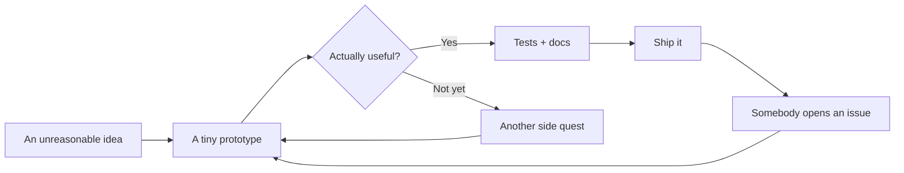

## 31 · Callouts, keyboard keys, math, and footnotes

> [!NOTE]
> GitHub renders these callouts natively. They can highlight project status or contribution instructions.

> [!TIP]
> A few carefully chosen links often beat ten dashboards.

> [!WARNING]
> This showroom contains a medically inadvisable amount of profile decoration.

**Keyboard styling:** <kbd>Ctrl</kbd> + <kbd>K</kbd>, then <kbd>Enter</kbd>.

**Math rendering:** $\text{side projects}_{n+1} = \text{side projects}_n + 1$

**Footnote:** Give a short statement a longer explanation without interrupting the page.[^footnote-demo]

[^footnote-demo]: This is a native GitHub Markdown footnote. In a final profile, it could explain a metric, a source, or an unusually specific joke.

## 32 · Expandable code and a readable diff

<details>
<summary>Open the profile configuration diff</summary>

```diff
- collect_every_widget: true
- introduce_myself: eventually
+ introduce_myself: first
+ favorite_widgets: a_few
+ show_actual_projects: absolutely
```

</details>

## 33 · ASCII identity, no external image required

```text
┌──────────────────────────────────────────────────────────────┐
│  cosipa@github                                               │
│                                                              │
│  status    exploring                                         │
│  projects  some useful / some educational / some inexplicable │
│  uptime    until the next interesting idea                   │
│                                                              │
│  [ sample copy — replace with actual personality ]            │
└──────────────────────────────────────────────────────────────┘
```

## 34 · A map inside Markdown

**NATIVE GITHUB FEATURE · example location, NOT your location.** GitHub can render GeoJSON. This point is the Royal Observatory in Greenwich, just to demonstrate the viewer. It may require loading the map when viewed on GitHub.

```geojson
{
  "type": "FeatureCollection",
  "features": [
    {
      "type": "Feature",
      "properties": { "name": "Example only: Royal Observatory, Greenwich" },
      "geometry": { "type": "Point", "coordinates": [-0.0015, 51.4779] }
    }
  ]
}
```

# G · The properly unnecessary stuff

## 35 · A daily generated scene

**LOCAL ANIMATED MOCKUP.** Tiny stars blink. This image does not currently change by day or reflect actual weather. A scheduled generator could change the moon, season, landscape, or colors.

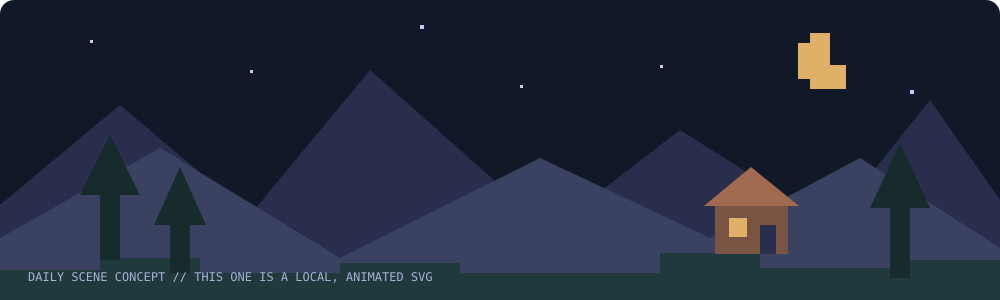

## 36 · A community game in your README

**LOCAL MOCKUP · no game is running.** A real version uses prefilled issue links to collect moves, then an Action validates the move and redraws the board. It needs spam protection, input validation, and carefully scoped permissions.

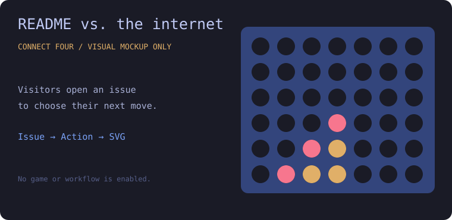

A README cannot run the game client-side. The interaction happens through GitHub issues and a trusted generator. **Never interpolate issue text directly into shell commands.**

## 37 · Rotating quote card

**LIVE SERVICE · not a personal endorsement of whatever quote appears.** Another example of content generated as an image. “Rotating” is subject to image caching.

[](https://github.com/PiyushSuthar/github-readme-quotes)

## 38 · The secret room

<details>
<summary>There is definitely nothing interesting behind this triangle.</summary>

```text
       /\_/\\
      ( o.o )   You made it through the widget swamp.
       > ^ <

      Achievement unlocked: actually scrolled the profile.
```

A place for a tiny joke, an Easter egg, a setup photo, or an explanation of how the profile generates itself.

</details>

<a id="recipes"></a>

# H · Recipes for things that need automation

**Reference snippets only.** These aren't installed, and this repository has no new workflows. Keep secrets in GitHub Actions secrets. Before enabling third-party actions, review them and pin them to reviewed commit SHAs; readable version tags below are only recipe examples.

<details>
<summary><b>Recipe: generate Cosipa's own snake on a separate asset branch</b></summary>

Put a reviewed version of this in `.github/workflows/profile-snake.yml`. It would create/update the **`profile-assets` branch**, not your main README. It runs daily or manually.

```yaml
name: Profile snake
on:
  workflow_dispatch:
  schedule:
    - cron: "23 5 * * *"
permissions:
  contents: write
concurrency:
  group: profile-snake
  cancel-in-progress: false
jobs:
  generate:
    runs-on: ubuntu-latest
    steps:
      - uses: Platane/snk/svg-only@v3
        with:
          github_user_name: ${{ github.repository_owner }}
          outputs: |
            .profile-output/snake.svg
            .profile-output/snake-dark.svg?palette=github-dark
      - uses: peaceiris/actions-gh-pages@v4
        with:
          github_token: ${{ secrets.GITHUB_TOKEN }}
          publish_dir: .profile-output
          publish_branch: profile-assets
```

Then embed:

```html
<picture>
  <source media="(prefers-color-scheme: dark)" srcset="https://raw.githubusercontent.com/Cosipa/cosipa/profile-assets/snake-dark.svg">
  
</picture>
```

Branch protection or repository policy may need additional configuration. Scheduled workflows can be delayed or disabled after long inactivity in public repositories.

</details>

<details>
<summary><b>Recipe: replace the example writing list from an RSS feed</b></summary>

Put a reviewed version in `.github/workflows/profile-posts.yml`. Replace the feed URL before enabling it. This example updates **`test.md`**, not `README.md`.

```yaml
name: Latest writing
on:
  workflow_dispatch:
  schedule:
    - cron: "41 6 * * *"
permissions:
  contents: write
concurrency:
  group: profile-posts
  cancel-in-progress: false
jobs:
  update:
    runs-on: ubuntu-latest
    steps:
      - uses: actions/checkout@v4
      - uses: gautamkrishnar/blog-post-workflow@v1
        with:
          readme_path: ./test.md
          feed_list: "https://YOUR-BLOG.example/feed.xml"
          max_post_count: 5
```

The Action writes between `BLOG-POST-LIST` markers. It needs a real reachable feed and permission to push the update. Protected branches can require a pull-request-based setup instead.

</details>

<details>
<summary><b>Recipe: your own dynamic widget without a public widget host</b></summary>

1. Keep a small input file in the repository, or fetch an API using an Actions secret.
2. Run a script on a schedule to produce an SVG or update a marked Markdown section.
3. Escape external strings before inserting them into XML/HTML. Never execute feed or issue content.
4. Publish the generated assets to a dedicated branch, or commit only when output changes.
5. Embed the raw SVG URL; keep important information available as ordinary text too.

This works for now-playing cards, books, public package downloads, recent releases, a personal now page, weather art, or a procedural pet.

**Why do it this way?** Your README can keep showing the last successful output even if the source API is temporarily unavailable. Do not publish private data accidentally: a secret used to fetch data does not make the resulting image private.

</details>

<details>
<summary><b>Why some famous widgets aren't embedded here</b></summary>

During construction, the original shared `github-readme-stats.vercel.app` endpoints returned HTTP 503, and the tested activity-graph and trophy shared hosts returned HTTP 402. A tested public Spotify example was also broken. Rather than knowingly embedding those failures, this page uses a working alternate stats host, summary-card graphs, Metrics achievement examples, and a local music mockup.

These are point-in-time checks, not a promise that any service will keep working. Also, HTTP 200 alone doesn't guarantee an SVG contains useful data.

GitHub sanitizes HTML. No arbitrary CSS, JavaScript, forms, iframe dashboards, autoplaying audio players, or client-side games. SVGs embedded as images cannot run scripts. Light/dark pictures, supported HTML attributes, declarative SVG animation, generated images, Mermaid, and Actions are the workarounds.

</details>

<a id="shortlist"></a>

# I · Keep / maybe / absolutely not

Pick numbers after viewing. Nothing is precious.

| Direction | Pieces to try |
| :-- | :-- |
| Clean builder | **02**, **19–23**, **27** |
| Terminal gremlin | **01**, **03**, **08**, **28**, **33**, **38** |
| Data dashboard | **09–13**, **16–17**, **26**, **29** |
| Pixel playground | **14–15**, **35–36** |
| Personal homepage | **04**, **20**, **23**, **25**, **27–28** |
| Just one nice thing | **02** + your actual projects |

- **Keep:**
- **Maybe:**
- **Nope:**

---

<p align="center"><a href="#the-everything-profile">↑ Back to the excessive amount of stuff ↑</a></p>


---

<a id="real-posts"></a>

# J · Actual posts from cosipa.dev, ten different ways

**REAL POSTS · RSS SNAPSHOT.** All four titles, publication dates, and article links below come from [cosipa.dev/rss](https://cosipa.dev/rss). Summaries are paraphrased from the feed. The custom cover illustrations are local showcase assets, not original article images. These sections are not automatically updating yet.

[Minimal](#39--minimal-dated-list) · [Editorial](#40--editorial-list-with-excerpts) · [Featured](#41--one-big-featured-post) · [Text cards](#42--two-column-text-cards) · [Image cards](#43--clickable-cover-gallery) · [Archive](#44--chronological-archive) · [Topics](#45--topic-shelves) · [Expandable](#46--expandable-post-previews) · [Magazine](#47--compact-magazine-rows) · [Badges](#48--ultra-compact-badge-links)

## 39 · Minimal dated list

### Latest writing

- **Oct 18, 2026** — [A user in the Docker group can become root](https://cosipa.dev/posts/docker-group-security-risk/)
- **Aug 05, 2026** — [How to setup a pull-through Docker registry](https://cosipa.dev/posts/docker-registry-cache-setup/)
- **Jul 25, 2026** — [How to speed up Linux disk encryption](https://cosipa.dev/posts/full-disk-encryption-tweaks/)
- **Oct 02, 2025** — [First post ever](https://cosipa.dev/posts/first-post-ever/)

[All posts →](https://cosipa.dev/) · [Subscribe via RSS](https://cosipa.dev/rss)

## 40 · Editorial list with excerpts

### Notes from the technical rabbit hole

#### [A user in the Docker group can become root](https://cosipa.dev/posts/docker-group-security-risk/)

**October 18, 2026 · Linux / Docker / Cybersecurity**

Docker socket access is more powerful than it looks. Why membership in the `docker` group can effectively grant root access, and why that matters for the host's security boundary.

#### [How to setup a pull-through Docker registry](https://cosipa.dev/posts/docker-registry-cache-setup/)

**August 5, 2026 · Docker / DockerHub / Cache**

Put a caching registry between your servers and DockerHub. A setup using a VPS and S3 storage, with fewer repeated pulls from upstream and less exposure to rate limits.

#### [How to speed up Linux disk encryption](https://cosipa.dev/posts/full-disk-encryption-tweaks/)

**July 25, 2026 · Linux / Encryption / Performance**

A look at `dm-crypt` performance tweaks on Linux 5.9 and later, including workqueue bypasses and the information-leakage tradeoff of passing discard requests through encryption.

<sub>And where it started: [First post ever · October 2, 2025](https://cosipa.dev/posts/first-post-ever/).</sub>

## 41 · One big featured post

### Featured writing

[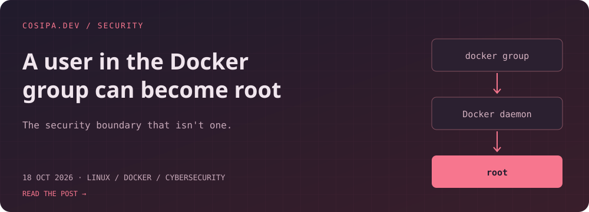](https://cosipa.dev/posts/docker-group-security-risk/)

**The `docker` group is not an ordinary convenience permission.** A closer look at the Docker socket, the root-running daemon, and what access to that API means.

**[Read the article →](https://cosipa.dev/posts/docker-group-security-risk/)**

**Also worth a look**
- [Build a pull-through Docker registry](https://cosipa.dev/posts/docker-registry-cache-setup/) — cache image pulls with a VPS and S3 storage.
- [Speed up Linux disk encryption](https://cosipa.dev/posts/full-disk-encryption-tweaks/) — performance tweaks and their tradeoffs.

## 42 · Two-column text cards

<table>
<tr>
<td width="50%" valign="top">

### 🛡️ Docker group → root

<sub>October 18, 2026 · Security</sub>

Docker socket access can effectively grant root privileges. A familiar warning, with consequences worth understanding.

**[A user in the Docker group can become root →](https://cosipa.dev/posts/docker-group-security-risk/)**

</td>
<td width="50%" valign="top">

### 📦 Pull once, cache it

<sub>August 5, 2026 · Infrastructure</sub>

A pull-through registry backed by S3, for repeated image pulls and DockerHub rate limits.

**[How to setup a pull-through Docker registry →](https://cosipa.dev/posts/docker-registry-cache-setup/)**

</td>
</tr>
<tr>
<td width="50%" valign="top">

### 🔐 Faster encrypted disks

<sub>July 25, 2026 · Linux</sub>

Tuning `dm-crypt` workqueues and discard behavior, without pretending performance has no security tradeoffs.

**[How to speed up Linux disk encryption →](https://cosipa.dev/posts/full-disk-encryption-tweaks/)**

</td>
<td width="50%" valign="top">

### ✏️ Before the rabbit holes

<sub>October 2, 2025 · Introduction</sub>

The introductory placeholder that opened the blog, before the technical posts arrived.

**[First post ever →](https://cosipa.dev/posts/first-post-ever/)**

</td>
</tr>
</table>

## 43 · Clickable cover gallery

**All four images are links.** Custom SVG covers; text remains available in the other layouts. No external card-rendering service needed.

<p>
  <a href="https://cosipa.dev/posts/docker-group-security-risk/"></a>
  <a href="https://cosipa.dev/posts/docker-registry-cache-setup/">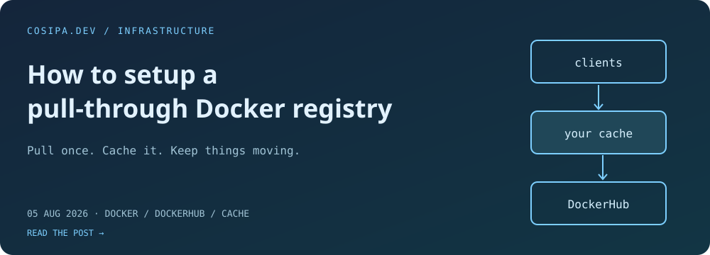</a>
</p>
<p>
  <a href="https://cosipa.dev/posts/full-disk-encryption-tweaks/"></a>
  <a href="https://cosipa.dev/posts/first-post-ever/"></a>
</p>

[More on cosipa.dev →](https://cosipa.dev/)

## 44 · Chronological archive

### 2026

| Date | Article | Feed categories |
| :-- | :-- | :-- |
| `Oct 18` | [A user in the Docker group can become root](https://cosipa.dev/posts/docker-group-security-risk/) | Linux, Docker, Cybersecurity, Root |
| `Aug 05` | [How to setup a pull-through Docker registry](https://cosipa.dev/posts/docker-registry-cache-setup/) | Docker, DockerHub, Cache |
| `Jul 25` | [How to speed up Linux disk encryption](https://cosipa.dev/posts/full-disk-encryption-tweaks/) | Linux, Encryption, Performance |

### 2025

| Date | Article | Feed categories |
| :-- | :-- | :-- |
| `Oct 02` | [First post ever](https://cosipa.dev/posts/first-post-ever/) | — |

## 45 · Topic shelves

*An editorial grouping, rather than a chronological feed. An article can appear on more than one shelf.*

### 🐧 Linux, security, and the host underneath

- **[A user in the Docker group can become root](https://cosipa.dev/posts/docker-group-security-risk/)** — understanding what Docker socket access permits.
- **[How to speed up Linux disk encryption](https://cosipa.dev/posts/full-disk-encryption-tweaks/)** — `dm-crypt` performance and security tradeoffs.

### 🐳 Containers and infrastructure

- **[How to setup a pull-through Docker registry](https://cosipa.dev/posts/docker-registry-cache-setup/)** — a caching proxy with S3-backed storage.
- **[A user in the Docker group can become root](https://cosipa.dev/posts/docker-group-security-risk/)** — why container administration is also host security.

### 🌱 The beginning

- **[First post ever](https://cosipa.dev/posts/first-post-ever/)** — the blog's initial hello.

## 46 · Expandable post previews

**A small footprint until someone wants details.** Each title opens a preview; the link inside opens the article.

<details>
<summary><b>A user in the Docker group can become root</b> · Oct 18, 2026</summary>

The Docker socket is the communication channel between clients and the daemon. The feed explains why permission to talk to that root-running daemon can effectively mean permission to become root on the host.

**Feed categories:** Linux, Docker, Cybersecurity, Root.

[Read on cosipa.dev →](https://cosipa.dev/posts/docker-group-security-risk/)

</details>

<details>
<summary><b>How to setup a pull-through Docker registry</b> · Aug 05, 2026</summary>

Instead of pulling every image directly from DockerHub, use your own caching registry. The post describes a setup on a VPS with S3 storage and discusses repeated pulls, upstream availability, and rate limits.

**Feed categories:** Docker, DockerHub, Cache.

[Read on cosipa.dev →](https://cosipa.dev/posts/docker-registry-cache-setup/)

</details>

<details>
<summary><b>How to speed up Linux disk encryption</b> · Jul 25, 2026</summary>

For Linux 5.9 and later: a discussion of `dm-crypt` workqueue bypasses and discard passthrough. The latter can help SSD space reclamation while revealing which encrypted blocks are unused.

**Feed categories:** Linux, Encryption, Performance.

[Read on cosipa.dev →](https://cosipa.dev/posts/full-disk-encryption-tweaks/)

</details>

<details>
<summary><b>First post ever</b> · Oct 02, 2025</summary>

The short welcome post that served as a placeholder while future technical articles were being planned.

[Read on cosipa.dev →](https://cosipa.dev/posts/first-post-ever/)

</details>

## 47 · Compact magazine rows

<table>
<tr>
<td width="35%" valign="middle">
<a href="https://cosipa.dev/posts/docker-group-security-risk/"></a>
</td>
<td valign="top">

**[A user in the Docker group can become root](https://cosipa.dev/posts/docker-group-security-risk/)**

<sub>October 18, 2026</sub>

Socket permissions, a root-running daemon, and the real power of the `docker` group.

</td>
</tr>
<tr>
<td width="35%" valign="middle">
<a href="https://cosipa.dev/posts/docker-registry-cache-setup/"></a>
</td>
<td valign="top">

**[How to setup a pull-through Docker registry](https://cosipa.dev/posts/docker-registry-cache-setup/)**

<sub>August 5, 2026</sub>

A caching proxy for DockerHub pulls, hosted on a VPS with S3 storage.

</td>
</tr>
<tr>
<td width="35%" valign="middle">
<a href="https://cosipa.dev/posts/full-disk-encryption-tweaks/"></a>
</td>
<td valign="top">

**[How to speed up Linux disk encryption](https://cosipa.dev/posts/full-disk-encryption-tweaks/)**

<sub>July 25, 2026</sub>

Performance tweaks for encrypted Linux disks, with the security tradeoffs included.

</td>
</tr>
</table>

[Browse the full blog →](https://cosipa.dev/)

## 48 · Ultra-compact badge links

**One small strip instead of a section full of cards.** Short labels link to the real posts; these badges are static labels, not live feed readers.

[](https://cosipa.dev/posts/docker-group-security-risk/)
[](https://cosipa.dev/posts/docker-registry-cache-setup/)
[](https://cosipa.dev/posts/full-disk-encryption-tweaks/)
[](https://cosipa.dev/posts/first-post-ever/)
[](https://cosipa.dev/rss)

---

**Writing layout shortlist:** `39` minimal · `40` editorial · `41` featured · `42` text cards · `43` cover gallery · `44` archive · `45` topics · `46` expandable · `47` magazine · `48` badges.

[↑ Back to the real-post layouts](#real-posts) · [Visit cosipa.dev](https://cosipa.dev/) · [RSS](https://cosipa.dev/rss)
