<!-- Profile shortlist. Layout stays hand-edited; marked regions are refreshed by GitHub Actions. -->

# Profile shortlist

[Working components](#working) · [Mockups & setup pending](#mockups) · [Blog layouts](#real-posts)

Original numbers are kept so we can keep referring to them. Everything is visible—no expanding sections.

# Working components

These components already render or refresh successfully. GitHub Actions updates the marked regions using public GitHub data and your RSS. Assets are repository-hosted; Komarev is the only separate widget service. Sample introduction copy is still yours to edit.

## 01 · Animated typing introduction

**Outlined Iosevka · sample copy.** Whole characters appear one at a time, pause, then erase one at a time. Separate light/dark lettering follows GitHub's selected theme. The glyphs are paths, so GitHub cannot substitute another font. Editable source: [`typing-iosevka.source.svg`](./profile-showcase/typing-iosevka.source.svg).

<!-- profile:typing:start -->

<!-- profile:typing:end -->

## 03 · Your terminal styling

Rosé Pine Moon, your two-line Fish/Starship prompt and branch symbol, no title bar or window buttons, and a steady beam cursor.

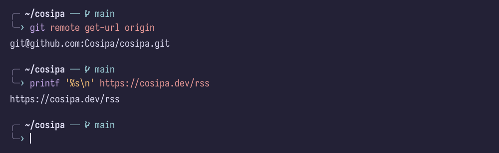

Styling recreation, not a screenshot. Uses the installed IosevkaTerm Nerd Font from your Kitty/Foot setup. Glyphs are rendered as paths so font fallback cannot change the image.

## 07 · Live GitHub badges

**Public GitHub data, rendered locally.** Rounded ends, subtle shading, and text shadows matching the other flat badges.

<!-- profile:github-badges:start -->

[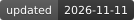](https://github.com/Cosipa/cosipa/commits)

<!-- profile:github-badges:end -->

## 18 · PGP + profile views

<!-- profile:pgp:start -->
[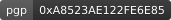](https://github.com/Cosipa.gpg)
<!-- profile:pgp:end -->

The key ID is from the primary public key served by your GitHub `.gpg` URL. Views are approximate image requests, not unique visitors.

## 09 · Public stats card

**Your public contribution data, with explicit calendar-year dates.** Commit contributions are GitHub-eligible public commits, not every Git commit on every branch. Any published private total is labeled contributions, never commits.

<!-- profile:stats:start -->
<a href="./profile-showcase/generated/stats-dark.713c756026a7.svg#gh-dark-mode-only">
  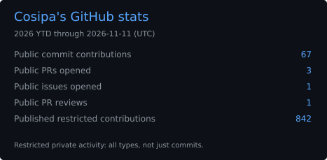
</a>
<a href="./profile-showcase/generated/stats-light.5e3c4a4270bf.svg#gh-light-mode-only">
  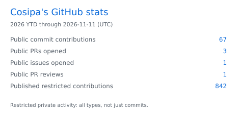
</a>
<!-- profile:stats:end -->

Original simple layout, GitHub-native light/dark backgrounds, and blue accents. Missing data is not presented as zero.

[Local generator](./scripts/update_profile.py) · [Counting definitions](./PROFILE_SETUP.md#counting-definitions)

## 12 · Contribution timeline

**Your publicly visible contributions over an explicit 365-day window.** The headline is checked against the sum of the daily counts. A blue/green line and shaded area show weekly totals; the green dot marks the busiest week.

<!-- profile:timeline:start -->
<a href="./profile-showcase/generated/timeline-dark.e8722b8fc2b1.svg#gh-dark-mode-only">
  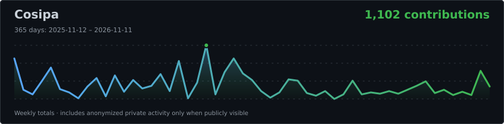
</a>
<a href="./profile-showcase/generated/timeline-light.ded74fbfe42a.svg#gh-light-mode-only">
  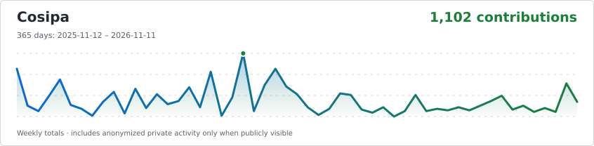
</a>
<!-- profile:timeline:end -->

Publicly published private activity may be included in the graph. Light/dark variants follow GitHub's selected theme, even when it differs from your browser/OS preference.

[GitHub's own contribution calendar](https://github.com/users/Cosipa/contributions)

## 14 · Contribution snake

**Your contribution grid.** A pink snake over the normal GitHub green contribution cells, with GitHub-native light/dark backgrounds. The pinned Action generates the animation; the local renderer applies the palette from `profile.toml`.

<!-- profile:snake:start -->

<a href="./profile-showcase/generated/snake-light.59a1d16f1a34.svg#gh-light-mode-only">
  
</a>
<!-- profile:snake:end -->

[Generator](https://github.com/Platane/snk)

## 24 · Open pull requests and issues

**Actual public activity, refreshed by Actions.** Up to 12 open items only, using locally stored status badges. Not an instant status check.

<!-- profile:activity:start -->
| Status | Repository | Title |
| :-- | :-- | :-- |
| 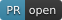 | `NixOS/nixpkgs` | [zap: install desktop icons](https://github.com/NixOS/nixpkgs/pull/585770) · #585770 |
|  | `NixOS/nixpkgs` | [fido2-manage: update to 0.2.2](https://github.com/NixOS/nixpkgs/pull/585745) · #585745 |
|  | `NixOS/nixpkgs` | [iproute2: 7.2.0 \-&gt; 7.3.0](https://github.com/NixOS/nixpkgs/pull/585573) · #585573 |
| 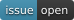 | `maxdorninger/MediaManager` | [\[BUG\] Prowlarr magnet redirect is discarded before Transmission grab](https://github.com/maxdorninger/MediaManager/issues/574) · #574 |
<!-- profile:activity:end -->

## 47 · Compact magazine rows

**Live writing · cosipa.dev.** Actions refreshes this and both excerpt alternatives from [your RSS feed](https://cosipa.dev/rss), retaining exact titles, dates, and first-sentence excerpts. No rewritten headlines or generated article images.

<!-- profile:posts47:start -->
<table>
<tr>
<td width="20%" valign="top">October 18, 2026</td>
<td valign="top">

**[A user in the Docker group can become root](https://cosipa.dev/posts/docker-group-security-risk/)**

> This is a well-known (very old) Docker security risk, that everybody knows exists, yet
> sometimes we underestimate the impact of it.

</td>
</tr>
<tr>
<td width="20%" valign="top">August 5, 2026</td>
<td valign="top">

**[How to setup a pull-through Docker registry](https://cosipa.dev/posts/docker-registry-cache-setup/)**

> A pull-through Docker registry is basically just a cached proxy to DockerHub, instead
> of having your servers pulling images from DockerHub directly, they could pull them
> from your own registry.

</td>
</tr>
<tr>
<td width="20%" valign="top">July 25, 2026</td>
<td valign="top">

**[How to speed up Linux disk encryption](https://cosipa.dev/posts/full-disk-encryption-tweaks/)**

> What is dm-crypt: Device-Mapper’s crypt provides transparent encryption of block
> devices using the kernel crypto API.

</td>
</tr>
</table>
<!-- profile:posts47:end -->

## 48 · Quieter excerpt layouts

Both alternatives below are already automated. Choose 47, 48A, or 48B for the final README.

### 48A · Ordinary blockquotes

<!-- profile:posts48a:start -->
> **[A user in the Docker group can become root](https://cosipa.dev/posts/docker-group-security-risk/)** · Oct 18, 2026
>
> This is a well-known (very old) Docker security risk, that everybody knows exists, yet
> sometimes we underestimate the impact of it.

<!-- -->

> **[How to setup a pull-through Docker registry](https://cosipa.dev/posts/docker-registry-cache-setup/)** · Aug 05, 2026
>
> A pull-through Docker registry is basically just a cached proxy to DockerHub, instead
> of having your servers pulling images from DockerHub directly, they could pull them
> from your own registry.

<!-- -->

> **[How to speed up Linux disk encryption](https://cosipa.dev/posts/full-disk-encryption-tweaks/)** · Jul 25, 2026
>
> What is dm-crypt: Device-Mapper’s crypt provides transparent encryption of block
> devices using the kernel crypto API.
<!-- profile:posts48a:end -->

### 48B · Unframed excerpts

<!-- profile:posts48b:start -->
**[A user in the Docker group can become root](https://cosipa.dev/posts/docker-group-security-risk/)** · Oct 18, 2026

This is a well-known (very old) Docker security risk, that everybody knows exists, yet
sometimes we underestimate the impact of it.

---

**[How to setup a pull-through Docker registry](https://cosipa.dev/posts/docker-registry-cache-setup/)** · Aug 05, 2026

A pull-through Docker registry is basically just a cached proxy to DockerHub, instead
of having your servers pulling images from DockerHub directly, they could pull them
from your own registry.

---

**[How to speed up Linux disk encryption](https://cosipa.dev/posts/full-disk-encryption-tweaks/)** · Jul 25, 2026

What is dm-crypt: Device-Mapper’s crypt provides transparent encryption of block
devices using the kernel crypto API.
<!-- profile:posts48b:end -->

---

# Mockups & setup pending

These are **not finished personal content**. Some are visual mockups; others have working rendering but still need your content or configuration. They are kept separate from the working data above.

## 04 · Native avatar + a centered intro

**Live avatar · introduction copy still a mockup.**

  

<h3 align="center">Cosipa</h3>

A short sentence about what you build, what you care about, and why someone should stick around.

  <a href="https://github.com/Cosipa?tab=repositories">Projects</a> ·
  <a href="https://github.com/Cosipa?tab=stars">Things I find interesting</a> ·
  <a href="https://cosipa.dev/">Writing</a>

## 05 · Flat tool badges

**Sample stack, not an inventory of your skills.** The assets work; the list still needs your selection.

## 17 · Metrics panels

**Unimplemented · upstream demos, not your account.** Metrics was explicitly excluded from the earlier Actions implementation because you planned to configure it yourself. That includes the achievement wall: no personal Metrics output or Metrics workflow has been configured here. These images are examples, not evidence of your stats or achievements.

### Achievement wall · not configured

## 19 · Repository preview card

**Placeholder.** No featured repository is selected yet.

<!-- profile:repository-placeholder:start -->

<!-- profile:repository-placeholder:end -->

## 21 · Two-column project gallery

**Illustrative copy, not actual project descriptions.**

<table>
<tr>
<td width="50%" valign="top">

### 🛠️ The useful thing

One sentence explaining the problem it solves, not just the language it's written in.

[Source](https://github.com/Cosipa?tab=repositories)

</td>
<td width="50%" valign="top">

### 🧪 The weird experiment

The one that exists because you wanted to understand how something works.

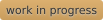

[Source](https://github.com/Cosipa?tab=repositories)

</td>
</tr>
</table>

## 22 · Release board

**Mockup · fictional projects and versions.**

| Project | Latest | What's new |
| :-- | :-- | :-- |
| `sidequest` | 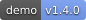 | Startup is no longer a coffee break. |
| `tiny-parser` | 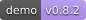 | Error messages now attempt to help. |
| `homelab-notes` | 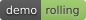 | Another diagram of the same server. |

## 37 · Your own quote card

**Working renderer · temporary demo quotes.** The entries in [`quotes.txt`](./quotes.txt) are explicitly labelled placeholders, not real quotations or your words. Replace them with your own content; the workflow selects one each UTC day and renders both themes. An empty file shows an explicit setup notice.

<!-- profile:quote:start -->
<a href="./quotes.txt#gh-dark-mode-only">
  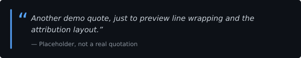
</a>
<a href="./quotes.txt#gh-light-mode-only">
  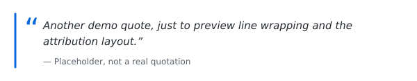
</a>
<!-- profile:quote:end -->

<!-- profile:footer:start -->

<!-- profile:footer:end -->
